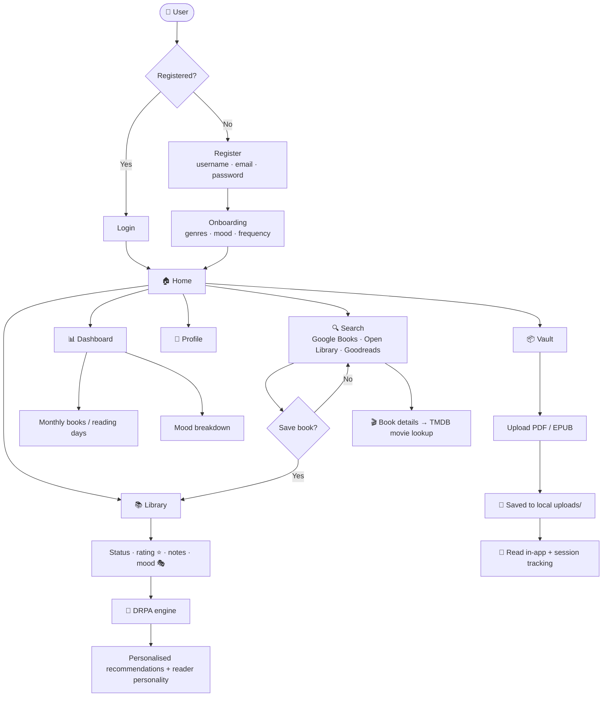
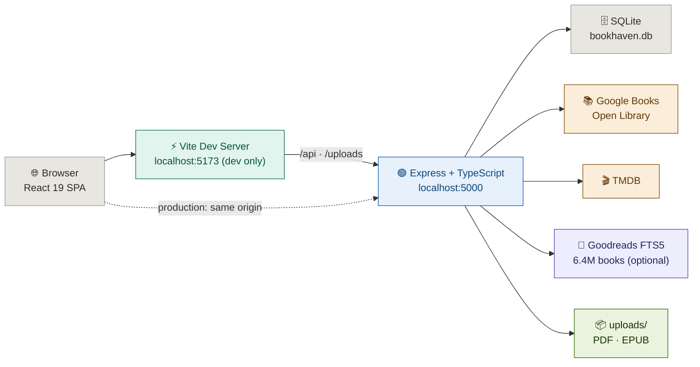

<div align="center">

[](https://github.com/ria0304/BOOKNEST)


# 📚 BookNest+ — Read More. Remember More. Discover Better.

**Search it. Shelve it. Read it. Get a recommendation that actually knows how you read.**

BookNest+ is a full-stack reading platform that combines multi-source book search, a personal library with ratings and moods, a private-file reading vault (PDF / EPUB), reading analytics, and a custom recommendation engine — **DRPA**, the Dynamic Reading Preference Algorithm — all running locally from a single Express server.

</div>

---

## The Problem

Reading life is scattered across apps that each do one thing badly.

**Readers** track books in one app, store ebooks in another, discover new ones through generic "readers also enjoyed" lists that ignore mood, taste strength, and what they are currently obsessed with — and never see a picture of their own habits.

**Recommendation engines** treat a 5-star book and a half-finished one as the same signal, and treat every Tuesday-night mood as irrelevant.

---

## The Solution

BookNest+ puts discovery, tracking, reading and analysis in one place, and feeds your *behaviour* back into what it suggests.

A reader can:

- **Search** — Google Books, Open Library, or a local 6.4M-book Goodreads dataset
- **Shelve** — Want to Read → Reading → Completed, with 1–5 star ratings, notes, and a mood per book
- **Read** — upload PDF / EPUB files to a personal vault and read them in the browser (EPUB via `epub.js`, PDF via embedded viewer), with reading sessions recorded
- **Reflect** — a dashboard of monthly activity and mood breakdown
- **Discover** — DRPA recommendations weighted by your ratings, moods, and onboarding preferences, plus a mood-matched mode

The system outputs:

- A **weighted taste profile** (authors, moods, and ratings, not just genres)
- A **reader personality** (e.g. *The Deep Thinker*, *The Voracious Reader*)
- **Personalised recommendations** that exclude everything already in your library
- **Monthly analytics** (books added, completed, reading days) and a **mood breakdown**

---

## Core User Flow

```
Register → Onboarding (genres · mood · reading frequency)
        ↓
Search (Google Books / Open Library / local Goodreads FTS5)
        ↓
Add to Library → set status · rate · note · log mood
        ↓
Read in the Vault (PDF / EPUB) → reading sessions recorded
        ↓
Analytics (monthly charts · mood breakdown)
        ↓
DRPA engine → weighted taste profile → personality + recommendations
        ↓
Book details → TMDB movie-adaptation lookup
```



---

## Features

| Feature | Status |
|---|---|
| Register / login with JWT, bcrypt-hashed passwords | ✅ |
| Onboarding (genres, mood, reading frequency) | ✅ |
| Book search — Google Books + Open Library | ✅ |
| Local Goodreads search — 6.4M books, SQLite FTS5 (optional import) | ✅ |
| Search reports upstream outages instead of silently returning nothing | ✅ |
| Personal library with status / rating / notes / mood | ✅ |
| Partial updates never wipe existing ratings or profile fields | ✅ (regression-tested) |
| PDF / EPUB vault (50 MB limit, extension-filtered) | ✅ |
| In-app EPUB reader (`epub.js`) and embedded PDF viewer | ✅ |
| Reading sessions (start / end / mood tagging) | ✅ |
| Dashboard — custom SVG charts (area, bar, donut) | ✅ |
| Current obsession (user-set) | ✅ |
| DRPA recommendations + reader personality | ✅ |
| Mood-based recommendations (source reported in response) | ✅ |
| Movie adaptation lookup (TMDB; labelled mock data without a key) | ✅ |
| Rate limiting, CORS allow-list, baseline security headers | ✅ |
| Dockerfile + Compose, persistent SQLite + uploads volumes | ⚠️ needs `JWT_SECRET` wired in — see [Docker](#docker) |
| CI/CD pipeline | ❌ none configured |

---

## DRPA — Dynamic Reading Preference Algorithm

DRPA builds a **weighted taste profile** from what you actually do, not just what you said at signup.

| Signal | How it is used |
|---|---|
| 📖 Reading history | Last 50 completed books, with ratings and moods |
| ⭐ Ratings | Weight per book = `0.4 + (rating / 5) × 1.6` — a 5★ book counts ~4× a 1★ book; unrated books count as `1` |
| 🎯 Genres | Chosen during onboarding |
| 🎭 Mood | Moods from completed books, plus logged moods (×0.5 each), plus the onboarding preferred mood (+1.5) |
| 🧠 Obsession | User-set current obsession, used for obsession-specific suggestions |
| 🔁 Frequency | Daily / Weekly / Monthly preference feeds the personality scoring |
| 🚫 Already owned | Everything in your library (matched by id and title) is excluded |

**Personality types** are scored and the highest wins: *The Voracious Reader*, *The Steady Scholar*, *The Daily Devourer*, *The Deep Thinker*, *The World Wanderer*, *The Discerning Critic*.

Candidates are pulled live from Google Books and Open Library, so recommendations need internet access.

---

## Architecture



In production there is one process: Express serves the built React app from `dist/`, the JSON API under `/api`, and uploaded files under `/uploads`.

---

## Data Model

SQLite (`better-sqlite3`), schema created automatically on first start, with in-place column migrations for older databases.

| Table | Purpose |
|---|---|
| `users` | Account, profile (name, gender, birthday), `onboarded` flag |
| `books` | Master book record (title, author, cover, source id) |
| `user_books` | A user's library: status, rating, notes, mood — unique per `(user, book)` |
| `user_preferences` | Genres, frequency, preferred mood, current obsession, last mood |
| `uploaded_books` | Vault files: title, `file_url`, size, original name |
| `reading_sessions` | Start / end, pages, duration, mood before / after |
| `mood_logs` | Ad-hoc "how am I feeling" entries from the dashboard |
| `goodreads_books` + `goodreads_fts` | Optional 6.4M-row dataset and its FTS5 index (porter + unicode61 tokenizer) |

---

## Tech Stack

**Frontend**
- React 19 + TypeScript + Vite 6
- React Router 7
- Tailwind CSS 4
- Framer Motion, Lucide React
- `epub.js` for in-browser EPUB reading
- Hand-built SVG charts (`src/components/charts.tsx` — area, bar, donut); no chart library

**Backend**
- Express 4 on Node 20, TypeScript run directly via `tsx`
- `better-sqlite3` — synchronous SQLite bindings, FTS5 search
- JWT (`jsonwebtoken`) + `bcryptjs`
- `multer` for uploads, `express-rate-limit` for throttling, `cors` allow-list
- esbuild bundles the server to `dist/server.cjs` for `npm run build`

**External APIs**
- Google Books API — search, covers, metadata (no key required)
- Open Library API — search and covers (no key required)
- TMDB API — movie adaptations (optional key)

**Tooling**
- Node's built-in test runner (`tsx --test`)
- Docker (`node:20-slim`) + Docker Compose

---

## Project Structure

```
BOOKNEST/
│
├── src/                              # React + TypeScript frontend
│   ├── components/
│   │   ├── Navbar.tsx                # Navigation bar
│   │   └── charts.tsx                # Custom SVG charts (Area / Bar / Donut)
│   ├── context/
│   │   └── AuthContext.tsx           # Auth state, token handling
│   ├── lib/
│   │   └── api.ts                    # apiFetch wrapper
│   ├── pages/
│   │   ├── Auth.tsx                  # Login / register
│   │   ├── Onboarding.tsx            # Genres, mood, frequency
│   │   ├── Home.tsx                  # Landing after login
│   │   ├── Search.tsx                # Multi-source search
│   │   ├── BookDetails.tsx           # Details + movie adaptations
│   │   ├── Library.tsx               # Status / rating / notes / mood
│   │   ├── Vault.tsx                 # Upload + in-app PDF / EPUB reader
│   │   ├── Dashboard.tsx             # Analytics + recommendations
│   │   └── Profile.tsx               # Profile editing
│   ├── App.tsx                       # Routing + protected routes
│   ├── index.css                     # Global styles
│   └── main.tsx                      # React entry point
│
├── tests/
│   └── api.test.ts                   # 23 API tests against a real server + throwaway DB
│
├── server.ts                         # Express API, DRPA engine, static hosting
├── db.ts                             # SQLite schema, migrations, FTS5 index build
├── import_goodreads.py               # Resumable Goodreads dataset importer
│
├── Dockerfile                        # Used by docker-compose.yml (single container)
├── Dockerfile.backend                # Alternate split deployment (not used by Compose)
├── Dockerfile.frontend               # Alternate split deployment (not used by Compose)
├── docker-compose.yml                # Port 80 → 5000, ./data and ./uploads volumes
│
├── index.html                        # Vite HTML entry
├── vite.config.ts                    # Dev proxy: /api and /uploads → :5000
├── tsconfig.json
├── package.json
├── .env.example                      # Environment variable template
├── .gitignore
└── LICENSE                           # MIT
```

---

## Run Locally

Requires **Node.js 20+**. Python 3 is only needed for the optional Goodreads import.

**Step 1 — Clone and install**

```bash
git clone https://github.com/ria0304/BOOKNEST.git
cd BOOKNEST
npm install
```

**Step 2 — Set up environment**

```bash
cp .env.example .env
```

Set `JWT_SECRET` (any long random string). In development the server falls back to an insecure default and warns; in production it **refuses to start** without one.

**Step 3 — Start the backend** (Terminal 1)

```bash
npm run dev
```

You should see:
```
Server running on http://localhost:5000
Uploads directory: .../uploads
```

> `npm run dev` starts **only the Express API**. It does not start Vite.

**Step 4 — Start the frontend** (Terminal 2)

```bash
npx vite
```

**Step 5 — Open the app**

```
http://localhost:5173
```

Vite proxies `/api` and `/uploads` to `localhost:5000`, so no CORS setup is needed.

**Alternative — single-process production mode**

```bash
npm run build      # vite build + bundles server to dist/server.cjs
npm start          # serves everything on http://localhost:5000
```

---

## Verify it's working

```bash
curl -X POST http://localhost:5000/api/auth/register \
  -H "Content-Type: application/json" \
  -d '{"username":"reader","email":"reader@example.com","password":"correct-horse-battery"}'
```

```bash
# an unknown API route returns JSON, not the SPA shell
curl http://localhost:5000/api/nope
```

**Run the tests**

```bash
npm test
```

23 tests run against a real server on a random free port with a throwaway SQLite database, so your development data is never touched. They cover: registration validation, duplicate handling, token issue/expiry/malformed tokens, library add/duplicate/range validation, the partial-update regressions (rating, notes, mood, name, gender, birthday), mood analytics, reading sessions (including ownership checks), upload and file-type rejection, upstream-outage reporting in search, JSON 404s, security headers, and CORS rejection.

---

## Optional: Goodreads Dataset

Local search runs against a copy of the Goodreads books dataset (6,389,859 books). The import is **resumable** — if interrupted, re-run the same command.

```bash
pip install pyarrow

python import_goodreads.py                 # resume, or no-op if complete
python import_goodreads.py --fresh         # drop the table and re-import
python import_goodreads.py --rebuild-fts   # force the FTS5 search index rebuild
```

The first run downloads the dataset (~16 GB cache) and takes a while. The server builds the FTS5 index on first start after import (several minutes) and skips the rebuild when the index is already current.

---

## Docker

```bash
docker-compose up --build
# → http://localhost:80
```

Compose builds `Dockerfile`, maps port `80 → 5000`, and mounts `./data` (SQLite, via `DB_PATH=/app/data/bookhaven.db`) and `./uploads`.

⚠️ **Compose sets `NODE_ENV=production` but does not pass `JWT_SECRET`**, and the server exits in production without one. Add it before building:

```yaml
    environment:
      - NODE_ENV=production
      - PORT=5000
      - JWT_SECRET=${JWT_SECRET}
```

Then run `JWT_SECRET=<your-secret> docker-compose up --build`. There is currently no `.dockerignore`, so `COPY . .` copies a local `.env` into the image — add one before pushing any image to a registry.

---

## Common Issues

| Problem | Fix |
|---|---|
| Container exits immediately | `JWT_SECRET` is missing in production — see [Docker](#docker) |
| `503 Frontend not built` at `localhost:5000` | Run `npm run build`, or use `npx vite` and open `:5173` |
| Frontend loads but API calls fail in dev | Backend isn't running — start `npm run dev` first |
| Port 5000 already in use | Set `PORT` in `.env`, or use `npm run dev:local` (port 3001) — and set `VITE_API_PROXY` to match |
| Browser blocked by CORS | Add your origin to `ALLOWED_ORIGINS` |
| Search returns a warning, not results | Google Books / Open Library was unreachable — the API reports this deliberately |
| Goodreads search returns empty | The `goodreads_books` table is empty; run `import_goodreads.py` |
| Movie data looks fake | `TMDB_API_KEY` is unset — the endpoint returns labelled mock data |
| `429 Too many attempts` | Auth limiter: 20 attempts per 15 min per IP |
| `better-sqlite3` build errors | Use Node 20 and a glibc-based image (`node:20-slim`, not Alpine) |

---

## Environment Variables

Create a `.env` in the project root (a template ships as `.env.example`):

| Variable | Required | Description |
|---|---|---|
| `JWT_SECRET` | ✅ in production | Signing key for tokens. Server exits in production without it; dev uses an insecure fallback and warns |
| `JWT_EXPIRES_IN` | No | Token lifetime — seconds (`900`) or duration (`12h`, `7d`). Default `7d`; invalid values warn and fall back to `7d` |
| `TMDB_API_KEY` | No | Enables real movie lookups. Without it, a labelled mock result is returned |
| `PORT` | No | Server port (default `5000`) |
| `DB_PATH` | No | SQLite file path (default `./bookhaven.db`; Docker uses `/app/data/bookhaven.db`) |
| `ALLOWED_ORIGINS` | No | Comma-separated CORS allow-list (default `http://localhost:5173,http://localhost:5000,http://localhost:80`) |
| `DISABLE_HMR` | No | `true` turns off Vite HMR |
| `VITE_API_PROXY` | No | Vite dev proxy target (default `http://localhost:5000`) |

No cloud credentials are required — files live on local disk.

---

## API Endpoints

All routes except register/login require `Authorization: Bearer <token>`. Unknown `/api/*` routes return a JSON 404.

**Auth and profile**

| Method | Endpoint | Description |
|---|---|---|
| `POST` | `/api/auth/register` | Register (username 3–32 chars, valid email, password 8–200 chars) |
| `POST` | `/api/auth/login` | Login, returns JWT |
| `GET` | `/api/auth/me` | Current user |
| `PUT` | `/api/auth/me` | Partial profile update |
| `POST` | `/api/auth/onboard` | Save onboarding preferences |
| `PUT` | `/api/preferences/obsession` | Set current obsession |
| `POST` | `/api/preferences/mood` | Log a mood |

**Library and vault**

| Method | Endpoint | Description |
|---|---|---|
| `GET` | `/api/library` | List the user's library |
| `POST` | `/api/library` | Add a book (duplicates refused) |
| `PUT` | `/api/library/:id` | Partial update: status, rating (1–5), notes, mood |
| `DELETE` | `/api/library/:id` | Remove a book |
| `POST` | `/api/vault/upload` | Upload PDF / EPUB (≤ 50 MB) |
| `GET` | `/api/vault` | List uploaded files |
| `DELETE` | `/api/vault/:id` | Delete an uploaded file |

**Search and recommendations**

| Method | Endpoint | Description |
|---|---|---|
| `GET` | `/api/books/search?q=&source=` | `source`: `google` (default), `openlibrary`, or `all` |
| `GET` | `/api/books/goodreads-search` | Local FTS5 search over the Goodreads dataset (limit ≤ 100) |
| `GET` | `/api/books/test-goodreads` | Goodreads dataset diagnostic |
| `GET` | `/api/books/details/:id` | Book details (Google Books) |
| `GET` | `/api/recommendations/drpa` | DRPA recommendations + reader personality |
| `GET` | `/api/recommendations/mood` | Mood-based recommendations |
| `GET` | `/api/ai/suggestions` | Rule-based suggestion cards (same-author, genre, mood) |
| `GET` | `/api/movies/search?title=` | TMDB adaptation lookup (mock without key) |

**Analytics and sessions**

| Method | Endpoint | Description |
|---|---|---|
| `GET` | `/api/analytics` | Stats by status and mood |
| `GET` | `/api/reading/monthly-books` | Monthly books added / completed / reading days |
| `POST` | `/api/reading/session/start` | Start a reading session (must own the book) |
| `POST` | `/api/reading/session/end` | End a session |
| `PATCH` | `/api/reading/session/:id` | Tag a running session with a mood |

---

## Security Notes

- Passwords hashed with `bcryptjs`; tokens signed with `JWT_SECRET`, expiry configurable
- Rate limits: **20 auth attempts / 15 min**, **300 API requests / min**
- JSON bodies capped at 1 MB; uploads capped at 50 MB, `.pdf` / `.epub` only, filenames sanitised
- CORS allow-list with `credentials: true`; `X-Content-Type-Options`, `X-Frame-Options`, `Referrer-Policy` headers; `x-powered-by` disabled
- ⚠️ **`/uploads` is served statically without authentication.** Anyone who knows or guesses a file URL (`<timestamp>-<name>`) can download it. Treat the vault as *unlisted*, not *private*, until this is gated behind auth.
- The JWT is kept in `localStorage`, which is readable by any script on the page.

---

## Known Limitations

- **Vault files are not access-controlled.** See Security Notes — this is the most important gap.
- **No CI/CD.** Builds and tests run locally only.
- **`npm run dev` doesn't start the frontend.** Run `npx vite` alongside it.
- **Docker needs a manual `JWT_SECRET` fix** and has no `.dockerignore`.
- **DRPA is a heuristic, not a trained model.** Its weights are hand-set and not validated against user outcomes.
- **Recommendations need the internet.** Candidates come from live Google Books / Open Library calls.
- **Search quality depends on the source.** Google Books and Open Library are rate-limited public APIs; Goodreads search requires a ~16 GB import.
- **Movie data is mock without `TMDB_API_KEY`.**
- **SQLite means single-node.** Fine for personal use, not for concurrent multi-server deployment.
- **Leftover naming and dependencies.** Parts of the codebase still say "Book Haven" (`bookhaven.db`, `metadata.json`, package name `react-example`), and `axios` and `@google/genai` are listed in `package.json` but not imported by the app.
- **`Dockerfile.backend` / `Dockerfile.frontend` are unused** by Compose and describe a split deployment that isn't wired up.

---

## Future Scope

| Feature | Why |
|---|---|
| Authenticated file serving for `/uploads` | Make the vault genuinely private |
| GitHub Actions: lint, test, build | Catch regressions before merge |
| Learned recommender (collaborative filtering or embeddings) | Replace hand-tuned DRPA weights with evidence |
| Reading goals and streaks | Habit tracking on top of existing session data |
| Goodreads / CSV library import for users | Cut the cold-start problem |
| Postgres + object storage | Multi-user hosted deployment |
| Mobile app (React Native) | Reading sessions and camera-based book lookup on the go |

---

## License

Released under the [MIT License](LICENSE).
